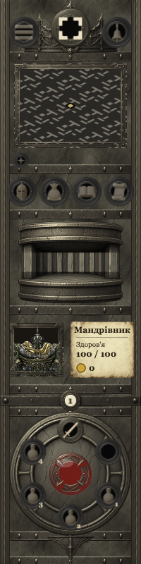

# Арт бічної панелі HUD — звіт

## Що зроблено

- **Тулінг.** `tools/imageUtils.ts`: `opaqueBounds`, `fitPlacement`, `cutHole`, `deriveMedallionState`
  (+ `removeSampledKey`), спеки в `tests/tools/imageUtils.test.ts`. `tools/uiArt.ts` будує всі ассети з
  `art/concepts/ui/` у `public/assets/ui/` (`node tools/uiArt.ts [name...]`).
- **Ассети** (`public/assets/ui/`, разом ≈ 0.9 МБ, найбільший файл — `panel_dial.png` 232 КБ):
  `panel_stone.jpg`, `panel_edge`, `panel_band`, `panel_crown`, `frame_minimap`, `panel_niche`,
  `frame_portrait`, `parchment`, `panel_depth`, `panel_dial`, `gem_mount`, `panel_finial`,
  `medallion_{normal,hover,pressed,disabled}`, `icon_{menu,bell,fullscreen,collapse,helmet,sack,book,scroll,compass,flask,sword}`.
  Сирі генерації — `art/concepts/ui/*.jpg` (поза git).
- **Завантаження.** `UI_ART_SCALE = 0.5` (`config.ts`); `UI_ART`, `uiAlias` і записи бандла `game` з
  `autoGenerateMipmaps: true` (`manifest.ts`).
- **Логіка.** `medallionLook` і `bandYs` у `PanelLayout.ts` + спеки.
- **`Medallion.ts`.** Підкладка й іконка — спрайти; текстура за `medallionLook`, натискання зсуває на 1 px;
  процедурні силуети, `glow` і `tint` прибрано.
- **`Hud.ts`.** Тло: `TilingSprite` каменю, два молдинги (правий віддзеркалений), `NineSliceSprite` ніші,
  пул поясів. Декор блоків — спрайти корони, рамок мінікарти й портрета, пергаменту, таблички глибини,
  циферблата, оправи самоцвіта, фініалу. Невживані кольорові константи й Graphics декору прибрано.
- **`AGENTS.md`.** §3 — `public/assets/ui/`; §4 — підрозділ «UI-арт».

## Виправлення після ручної перевірки: палітра «до каменю»

Відгук: панель надто тепла, коричнево-бронзова; у референсі — холодний сіро-оливковий камінь, метал лише
акцентами. Заміри: у референсі насиченість каменю ≈ 0.3, відтінок R > G > B лише на 10–20; у наших ассетах
насиченість була 0.35–0.48 з помаранчевим зсувом.

- `stoneGrade(data, keep, gain)` у `tools/imageUtils.ts` (чиста функція, спеки в
  `tests/tools/imageUtils.test.ts`). Лишає `keep` насиченості, накладає сіро-оливковий відтінок зі
  збереженням яскравості й множить яскравість на `gain`.
- `tools/uiArt.ts`: поле `grade` в таблиці ассетів.
  - `STONE` (`keep 0.3`, `gain 1.12`) отримують молдинги, пояси, корона, ніша, обидві рамки, табличка
    глибини, циферблат, оправа самоцвіта, фініал і `medallion_normal`. Hover, pressed і disabled
    виводяться з уже скоригованого normal, тож hover лишає теплий золотий відблиск як акцент.
  - Тайл каменю: `keep 0.3`, `gain 0.9` — темніший за оздоблення, як плита в референсі.
  - Пергамент лише ледь приглушено (`keep 0.6`). Іконки й самоцвіт не змінювались.
- Перегенерація через GenerateImage не знадобилась: усе вирішила корекція, сирі файли ті самі.
- `screenshot.png` оновлено. Поруч із `reference.png` гама тепер близька: сірий різьблений камінь,
  бронза лише в заклепках і обідках. Деталі не скопійовано.

## Відхилення від плану (і чому)

- **Збірка ламалась через `Buffer`.** Чисті функції `imageUtils.ts` тепер приймають `Uint8Array`
  (Buffer — його підклас, тож скрипти не змінились), у `sliceSheet` прибрано явний тип `Promise<Buffer[]>`.
  Без нових залежностей і без змін `tsconfig`.
- **Ніша: 9-slice 88 px замість 56.** Згенеровані торцеві капітелі вищі (≈ 70–80 файлових px). Режим
  `caps` в `uiArt.ts` тепер збирає верхній торець + смужку канелюр з центру арту (`mid: 16`) + нижній
  торець; `topHeight/bottomHeight = 88`, тож тягнуться лише канелюри. На низькій колоні Pixi пропорційно
  стискає торці.
- **Вікно мінікарти під рамкою — темна підкладка `Graphics`** (як був фон вікна раніше), щоб вікно
  лишалось темним поза намальованою картою. Аналогічно лишено темне «скло» під рідиною самоцвіта.
- **`reference.png`** передавався в `GenerateImage` для якорів і декору (варіант А), але не для
  `parchment` (матеріал там не потрібен). `frame_portrait` перегенеровано один раз: перша версія була без
  magenta-фону (рамка до країв кадру).
- **Крок 9:** `Статус: done` не виставлено й нічого не закомічено — за інструкцією.

## Результат lint / test

- `npm run lint` — чисто (ESLint + Prettier).
- `npm run test` — 9 файлів, 51 тест пройшли.
- `npm run build` — `tsc --noEmit` + `vite build` успішні.
- `npm run data:check` — не запускався: JSON-дані не змінювались (і такого скрипта в `package.json` немає).

## Що перевірити вручну

1. [ ] `npm run dev`: панель мальована — кам'яна плита, бронзові молдинги по боках, залізні пояси з
       заклепками на межах блоків; корона, рамки мінікарти й портрета, пергамент, циферблат, оправа самоцвіта,
       фініал. Процедурних смуг/ромбиків старої панелі немає.
2. [ ] Мінікарта рівно у вікні рамки, без щілин; герой — у вікні рамки портрета.
3. [ ] Змінити висоту вікна: камінь тайлиться без видимих швів, молдинги тягнуться на всю висоту, ніша
       тягнеться лише канелюрами (торці не спотворені); дуже низьке вікно — ніша зникає, низ обрізається.
4. [ ] Масштаб 0.7 (низьке вікно) — дрібні деталі не мерехтять при русі героя; масштаб 1.4 — арт не
       «милий», тексти чіткі.
5. [ ] Медальйони: наведення — кільце світлішає й теплішає; затиснути «Повний екран» — темніє й осідає на
       1 px; заглушки — сірі, іконка притемнена, на наведенні — теплий стан і тултіп «Ще недоступно»; слот ЛКМ
       не реагує на наведення/натискання, але показує тултіп. Іконка повного екрана міняється на «згорнути»
       (кнопка і `F`).
6. [ ] Кнопка Tab (компас, r 11) читається при 0.7. **Ризик:** на скриншоті при масштабі 1 вона вже дуже
       дрібна; якщо нечитабельно — фолбек на процедурний силует (план, відкрите питання 3).
7. [ ] Отримати удар — рідина самоцвіта падає під оправою (пазурі оправи лежать поверх рідини); тексти
       здоров'я/золота на пергаменті читаються.
8. [ ] Немає рожевої кайми навколо елементів (на скриншоті не видно; ледь помітна зеленкувата лінія на
       верхньому краї `panel_niche` — перевірити зблизька). Звірити скриншот із `reference.png`: стиль
       близький, деталі не скопійовані.
9. [ ] Корона здебільшого прихована за трьома медальйонами (арт вписано `contain` у 200×80) — оцінити,
       чи вистачає її видимості.
